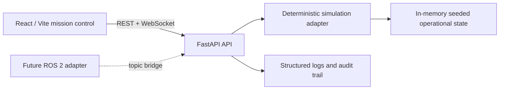

# ATLAS — Autonomous Teleoperation & Logistics Administration System

ATLAS is a locally runnable, deterministic robotics fleet-operations simulation designed as a Forward Deployed Engineer portfolio project. It models the operational surface of an AMR deployment: fleet monitoring, simulated teleoperation, mission control, navigation, diagnostics, customer deployments, support, and analytics.

> Safety: this project runs only a local simulation adapter. Physical robot control and ROS 2 connection are disabled by default and are not implemented as active transports.

## Highlights

- Aerospace-style mission-control interface with interactive facility map and live WebSocket fleet updates.
- Five seeded AMRs, historical telemetry, deterministic reset, missions, alerts, deployments, support tickets, and audit records.
- Server-authoritative FastAPI simulation: validated teleop commands, emergency stop, mission preflight, mission lifecycle, fault injection, and resolution.
- CSV log export, analytics derived from the API, deployment readiness report, and guided demo scenario.

## Architecture



The current deliberately compact portfolio build uses deterministic in-memory state so Reset is immediate and reproducible. The API boundary is designed for a SQLAlchemy repository and/or a ROS 2 adapter in a deployment build; see [docs/ROBOTICS_INTEGRATION.md](docs/ROBOTICS_INTEGRATION.md).

## Stack

Frontend: React, TypeScript, Vite, React Router, Recharts, Lucide. Backend: Python, FastAPI, Pydantic, WebSockets, Pytest. Default mode: local simulation with no cloud dependency.

## Run locally

Prerequisites: Python 3.10+ and Node.js 20+.

```bash
cp .env.example .env
chmod +x start-atlas.sh
./start-atlas.sh
```

Or start each process manually:

```bash
cd backend && python3 -m venv .venv && . .venv/bin/activate
pip install -r requirements.txt
uvicorn app.main:app --reload --port 8000

# in another terminal
cd frontend && npm install && npm run dev
```

- UI: http://localhost:5173
- API: http://localhost:8000
- Swagger: http://localhost:8000/docs

Docker: `docker compose up --build` (frontend is served on 5173 and backend on 8000).

## Tests

```bash
cd backend && . .venv/bin/activate && pytest -q
cd frontend && npm test
```

Backend tests cover health, fleet/telemetry, mission preflight and lifecycle, emergency-stop command rejection, fault injection, alert resolution, readiness, audit events, and reset.

## Demo: Northstar Logistics / Noida DC

1. Open Command Center and point out ATLAS-03 executing, ATLAS-04 battery attention, and ATLAS-05 degraded link.
2. Open Teleoperation, select ATLAS-01, issue movement, then use Emergency Stop and show rejection of subsequent movement.
3. Create a mission for ATLAS-01; run preflight, start, pause/resume it.
4. Inject a network degradation fault in Diagnostics, observe the event in Logs, then resolve the alert.
5. Open Deployments for the readiness report and Analytics for backend-derived utilization/battery metrics.
6. Use Settings → Reset simulation to restore the baseline.

## Screenshots

The source package deliberately does not include fabricated screenshots. Run the app and capture the Command Center and Teleoperation screens for a portfolio/GitHub README.

## Project layout

```text
backend/app/main.py       FastAPI routes and deterministic simulator
backend/tests/            API test suite
frontend/src/             React mission-control application
docs/                     architecture, API, robotics, demo, tests, decisions
start-atlas.*             local startup helpers
```

## Limitations and next steps

- State is deterministic in memory rather than persisted SQLite/SQLAlchemy; restarting or resetting restores the known demo state.
- The facility visualization is a purpose-built tactical SVG/CSS map, not a SLAM map renderer.
- Camera is explicitly simulated. No physical transport exists.
- A production continuation should add SQLAlchemy migrations, auth/RBAC, durable event storage, Playwright browser tests, and a pluggable ROS 2 bridge.

Read [docs/ARCHITECTURE.md](docs/ARCHITECTURE.md), [docs/API.md](docs/API.md), [docs/DEMO_GUIDE.md](docs/DEMO_GUIDE.md), and [docs/TESTING.md](docs/TESTING.md) for implementation details.
