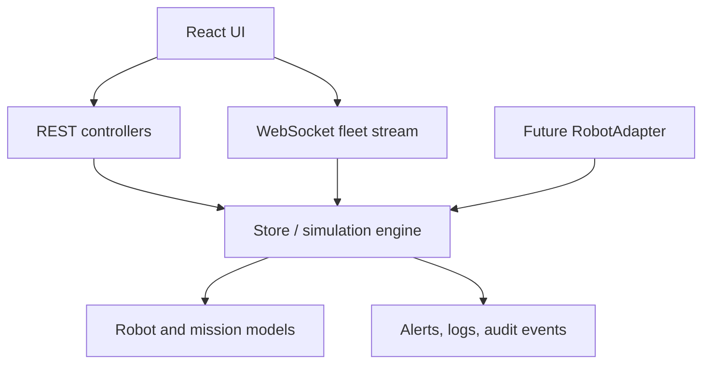

# Architecture

ATLAS separates presentation from a server-authoritative simulator. The React client only renders state returned by REST or WebSocket endpoints. FastAPI owns movement, safety decisions, mission transitions, faults, telemetry ticks, logs, and audit events.

The running simulator has a seeded random source reserved for deterministic update behaviour. It ticks once per second, updates executing robots, consumes battery, updates heartbeat/temperature, advances mission progress, and emits current fleet state over `/ws/fleet`.

The persistence seam is the store. A SQLAlchemy repository can replace it without changing UI contracts. The packaged local demo intentionally uses resettable memory state, avoiding an opaque database artifact in source control.
